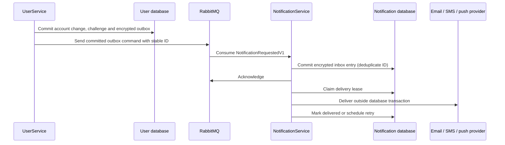

# NotificationService

NotificationService is the only service that contacts email, SMS and mobile-push providers. Producers send `NotificationRequestedV1` from `EasyTolet.Contracts` to the durable RabbitMQ queue `easytolet-notifications-v1` using `INotificationPublisher` from Shared. No public notification-sending endpoint is exposed.



## Current integrations

UserService publishes password-reset, email-verification, phone-verification and account-deletion confirmation requests. It keeps its original transactional account outbox and owns confirmation validation. `UserAccountMessages.DeliveredAtUtc` is a legacy column name: it now records RabbitMQ acceptance, not final provider delivery. Existing protected account-outbox payloads are readable; older payloads derive a stable creation timestamp from their 15-minute expiry.

Other services currently have no notification-producing business workflows implemented. They can use the shared contract/publisher when their workflows are added. They must not install provider clients or store SMTP/SMS/push credentials. AdminService's role event bus/outbox remains independent.

## Setup

1. Apply `database/NotificationInbox.sql` to **NotificationService's database only**. UserService still requires `database/UserAccountActivities.sql` in its own database. No service reads another service's database. The application does not run schema scripts automatically.
2. Configure both services with the same RabbitMQ host/virtual host. Use `RabbitMq:Address` (for example `rabbitmqs://broker.example/easytolet`) and `RabbitMq:Username` / `RabbitMq:Password`, or the existing `RabbitMq:Host` for local development. Durable commands are sent directly to a queue, so subscription startup ordering does not discard published requests. Broker publisher confirmations must remain enabled (MassTransit default).
3. Gmail is configured in **NotificationService** as `smtp.gmail.com:587`, mandatory STARTTLS, sender/username `vamsib508@gmail.com`. Set `Notifications__Email__Password` through an environment variable, deployment secret, or `Notifications:Email:Password` in the `EasyTolet.NotificationService` user-secret store. The previous UserService `AccountDelivery:Email:Password` secret is no longer used. Never commit a password. A Gmail app password is needed; see [Google's instructions](https://support.google.com/accounts/answer/185833).
4. Persist `Notifications:DataProtectionKeyDirectory` on a private volume shared by NotificationService replicas. Persist UserService's separate `AccountOutbox:DataProtectionKeyDirectory` across its own replicas. These are **separate key rings and application names**, not keys shared between services. Protect key storage with deployment access controls and encryption. Existing UserService keys/application name remain unchanged.
5. SMS and push are disabled by default. Configure `Notifications:Sms:Endpoint` / `ApiKey` and `Notifications:Sms:Enabled=true` when an SMS provider adapter is available. For mobile push use `Notifications:Push:Endpoint` / `ApiKey` and `Notifications:Push:Enabled=true`. Enable `AccountFeatures:PhoneVerificationEnabled` in UserService only after NotificationService's SMS path is configured. No live SMS/push provider is assumed or contacted.

Broker commands contain private recipients and confirmation tokens in transit. Use TLS (`rabbitmqs`), private broker access, restricted publisher/consumer credentials and retention policies on queues/error queues. Do not log message bodies. Data Protection encrypts producer outbox and consumer inbox storage, but does not encrypt RabbitMQ's serialized payload. Invalid commands or repeated consumer database failures go to MassTransit's error queue; inspect and replay them through restricted operational tooling. Do not expose that queue to clients.

## Contracts and provider ownership

`NotificationRequestedV1` contains a globally unique `NotificationId`, `Source`, `Channel` (`email`, `sms`, `push`), `Recipient`, `Template`, `Data`, `CreatedAtUtc`, and `ExpiresAtUtc`. Timestamps are UTC; maximum requested lifetime is seven days. Keep every field, including creation time, unchanged when retrying the same ID. A reused ID with different content is rejected. `Source` is tracing metadata, not an authorization credential; RabbitMQ permissions define trusted producers.

NotificationService owns these templates:

| Template | Channel | Data |
| --- | --- | --- |
| `account.reset` | email | `token` |
| `account.email` | email | `token` |
| `account.delete` | email | `token` |
| `account.phone` | sms | `token` |
| `message` | email / sms / push | `subject`, `body` |

Email is plain text. Account tokens retain their 15-minute expiry, and are sent to the user's contact, not to the configured sender address. The `message` template allows future services to request general transactional notifications. Mobile push uses a device/provider token as the recipient; device registration, consent and token lifecycle belong to the application workflow and are not invented from user phone numbers. The account confirmation templates do not support the push channel.

SMS and push use configurable HTTPS provider adapters. The adapter must translate this normalized contract to the selected provider (for example an SMS vendor or FCM/APNs); configuring a raw vendor URL alone is insufficient unless it accepts this contract:

```json
{
  "notificationId": "message-guid",
  "channel": "push",
  "recipient": "device-token",
  "subject": "Booking update",
  "body": "Your booking was confirmed.",
  "expiresAtUtc": "2030-01-01T00:15:00Z"
}
```

The service adds `Authorization: Bearer <ApiKey>` and `Idempotency-Key: <notificationId>`. Redirects are disabled and requests time out after 15 seconds. The provider adapter must honor the idempotency key and return 2xx only after accepting durable responsibility. Configuration and credentials live only in NotificationService.

## Retry and duplicate behavior

The consumer validates and commits to a durable inbox before acknowledging RabbitMQ. Duplicate IDs with matching content do not reset status or resend completed messages. Consumer database errors retry after 1, 5 and 15 seconds before MassTransit moves the command to its error queue. Invalid commands are not retried.

Delivery workers claim rows with a one-minute lease and `FOR UPDATE SKIP LOCKED`, commit, then contact providers. Conditional acknowledgments prevent stale workers overwriting a newer lease. Failed sends retry after one minute, up to ten attempts; terminal failures are marked `Failed` with a sanitized code. Disabled channels stay pending and are not claimed until enabled; expiry still applies. Expired rows are marked `Expired`. Delivered, expired and terminally failed rows have their protected payload cleared. Invalid protected payloads are terminal rather than blocking the worker indefinitely.

Delivery is at least once. A crash after provider acceptance but before database acknowledgment can repeat a send. SMS/push adapters must deduplicate the stable ID. SMTP uses a stable Message-ID but cannot guarantee exactly-once delivery. An account challenge consumed after broker publication may still produce a message; UserService's single-use/expiry checks remain authoritative and reject the token.

Monitor `NotificationInbox.Status`, `Attempts`, `LastErrorCode`, pending age and the broker error queue. Queue acceptance is not proof of email/SMS/push delivery. Provider acknowledgments also do not prove that an end user read the message. Retain deduplication metadata at least through message expiry and broker replay retention; configure cleanup of older terminal rows separately.

## Adding another producer

Services already reference Shared, which references the contract. A host without MassTransit registration can call:

```csharp
builder.Services.AddNotificationProducerMessaging(builder.Configuration);
```

A service with an existing bus (such as AdminService) calls `AddNotificationPublisher()` and uses that same bus; never register a second MassTransit bus just for notifications.

Persist the complete command and a stable ID in that service's own outbox in the same `IUnitOfWork` transaction as the business change. Its dispatcher calls `INotificationPublisher.PublishAsync(command, ct)` after commit and marks the row published only after broker success. A direct controller publish is not transactional and is not an approved substitute. Recipient selection, user consent and business authorization belong to the producer. Provider credentials, rendering and delivery belong to NotificationService.

## Tests

```sh
dotnet test tests/EasyTolet.NotificationService.Tests/EasyTolet.NotificationService.Tests.csproj --disable-build-servers -m:1 /p:UseSharedCompilation=false
dotnet test tests/EasyTolet.UserService.Tests/EasyTolet.UserService.Tests.csproj --disable-build-servers -m:1 /p:UseSharedCompilation=false
dotnet build EasyToLet.sln --disable-build-servers -m:1 /p:UseSharedCompilation=false
```

Unit tests use fake provider transports and SQL boundaries. In-memory MassTransit tests exercise the shared publisher, serialization, consumer and message identity without RabbitMQ. They do not prove RabbitMQ topology, MySQL locking, or live provider behavior.

Optional infrastructure tests require `EASYTOLET_NOTIFICATION_TEST_MYSQL` pointing to an isolated schema ending `_tests` with `NotificationInbox.sql` installed and no pending deliveries; they verify concurrent deduplication, lease exclusion, stale completion protection and completed-message replay. RabbitMQ tests require `EASYTOLET_TEST_RABBITMQ_ADDRESS`, `EASYTOLET_TEST_RABBITMQ_USER`, `EASYTOLET_TEST_RABBITMQ_PASSWORD`, and a dedicated virtual host ending `_tests`. Do not run an application consumer in that test virtual host. The durable test queue remains afterward. Without explicit configuration these tests are skipped. Live Gmail/SMS/push delivery is not exercised by automated tests.
